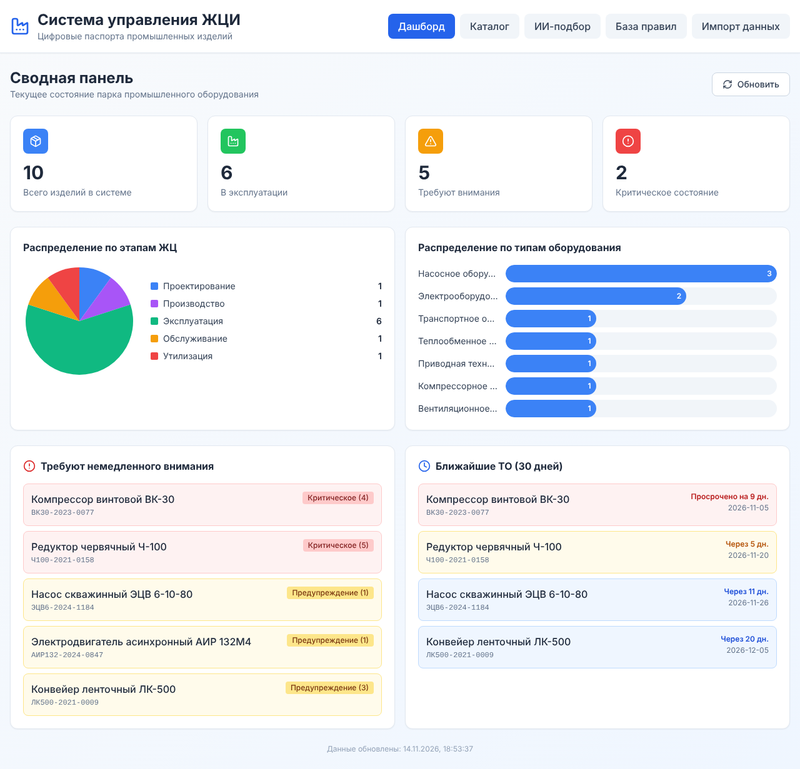
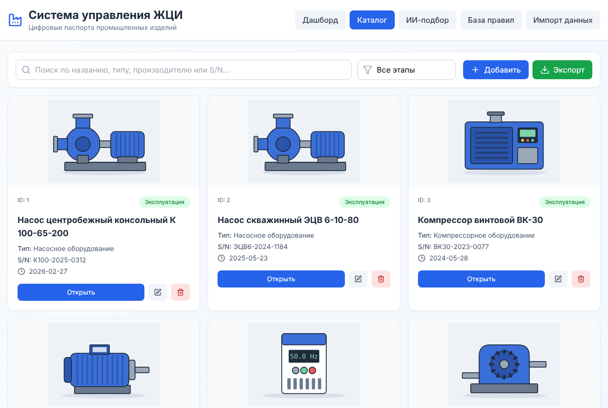
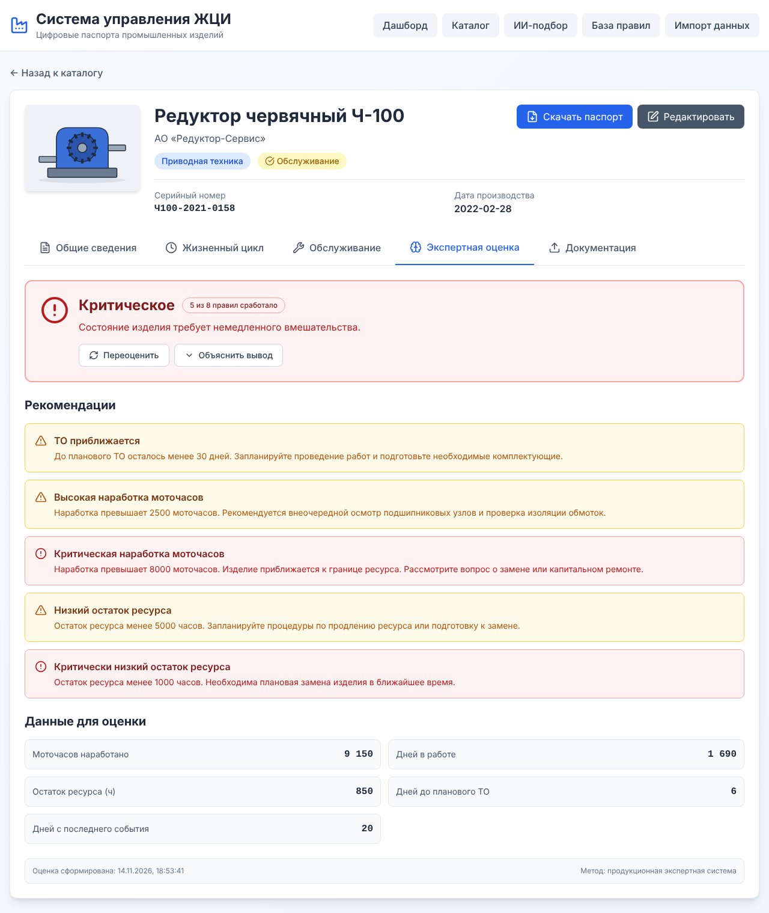

# Цифровые паспорта оборудования

Веб-система управления жизненным циклом промышленного оборудования (PLM).
У каждого изделия есть цифровой паспорт: характеристики, история от проектирования
до списания, данные обслуживания и документы. Экспертная система оценивает состояние
оборудования по набору правил, а ИИ-подбор находит в каталоге подходящее оборудование
по описанию задачи обычными словами.

Изначально проект сделан как выпускная квалификационная работа (защищена на «отлично»),
затем доработан: архитектура фронтенда, демо-данные, ИИ-подбор, развёртывание в Docker.



## Возможности

- **Каталог** с поиском и фильтром по этапу жизненного цикла, импорт из Excel/CSV/JSON
  с предпросмотром и экспорт в Excel.
- **Карточка изделия:** характеристики, история ЖЦ, обслуживание (наработка, остаток
  ресурса, срок следующего ТО), документы.
- **PDF-паспорт с QR-кодом.** QR ведёт на электронную карточку изделия.
- **Экспертная система.** Продукционные правила вида «если наработка > 8000 ч, то
  критическое состояние: рассмотреть капремонт». Правила хранятся в базе и
  редактируются в интерфейсе без изменения кода. Вывод можно раскрыть и посмотреть,
  какие факты и правила к нему привели.
- **Дашборд:** состояние парка оборудования, распределение по этапам и типам,
  изделия, требующие внимания, ближайшие ТО.
- **ИИ-помощник главного механика** и **подбор по описанию задачи** (см. ниже).
- **Демо-парк предприятия:** ~240 единиц оборудования по цехам, насосной, котельной,
  водозабору и складу резерва, с историей ТО и наработкой (см. `backend/demo-fleet.js`).

| Каталог | Экспертная оценка |
|---|---|
|  |  |

## ИИ-помощник механика: как устроен

Пользователь спрашивает обычными словами: «что требует ТО в ближайшие две недели?»,
«есть ли в резерве насос на замену с подачей от 8 м³/ч?», «что в критическом состоянии
в Цехе №2?». Работает по схеме **function calling**:

1. Модели передаётся вопрос и описание пяти инструментов: поиск по парку, план ТО,
   поиск замены в резерве (с требованием к характеристике), сводка по парку,
   карточка изделия.
2. Модель сама решает, какой инструмент вызвать и с какими аргументами, например
   `find_reserve({"query": "насос", "spec": "Подача", "min": 8})`.
3. Сервер выполняет инструмент обычным запросом к базе и возвращает результат модели.
   Шаги 2–3 повторяются, пока модель не ответит текстом (не больше шести раз).

Ограничения, которые держит код, а не модель:
- модель не видит базу и не пишет SQL — только просит один из пяти инструментов,
  все инструменты **только читают**;
- ссылаться на изделия модель может только по id из результатов инструментов:
  `[#123]` становится ссылкой на карточку, чужие id вырезаются;
- ход работы (какие запросы к базе сделаны) показывается пользователю под ответом.

Без модели помощник отвечает обычным поиском по парку. Тесты: `npm test` в `backend`.

## Подбор по описанию: как устроен

Пользователь пишет задачу, например «нужен насос для скважины 60 м, подача 8 м³/ч».
Подбор работает по схеме RAG (retrieval-augmented generation):

1. **Поиск.** Изделия ранжируются по совпадению слов запроса с названием, типом
   и характеристиками, с учётом предметных синонимов («скважина» → скважинный насос,
   «сжатый воздух» → компрессор).
2. **Генерация.** Лучшие кандидаты вместе с этапом ЖЦ и заключением экспертной системы
   передаются языковой модели. Модель выбирает **только из переданного списка**,
   сравнивает характеристики с требованиями и объясняет выбор. Ответ проверяется:
   изделия, которых не было в списке, отбрасываются.

Модель подключается через OpenAI-совместимый API, поэтому подходит и облачная
(DeepSeek), и локальная (Ollama, LM Studio). Смена модели — три переменные окружения
в `backend/.env`, без изменения кода. Если модель не настроена или недоступна,
подбор работает в режиме поиска по каталогу.

## Стек

| Часть | Технологии |
|---|---|
| Фронтенд | React 19, Vite, Tailwind CSS, jsPDF, SheetJS, Papa Parse |
| Бэкенд | Node.js, Express, SQLite (better-sqlite3), Multer |
| ИИ | Любая LLM с OpenAI-совместимым API |
| Развёртывание | Docker, Docker Compose, Caddy (автоматический HTTPS) |

## Запуск локально

Нужен Node.js 20.12 или новее.

```bash
npm run build      # установить зависимости и собрать фронтенд
npm start          # сервер на http://localhost:4000
```

При первом запуске создаётся база с демо-каталогом из 10 изделий. Даты в демо-данных
считаются от текущего дня, поэтому демо не «устаревает». Сбросить базу к демо-состоянию:
`npm run reset-demo --prefix backend`.

Для разработки фронтенда с горячей перезагрузкой: `npm start` в одном терминале
и `npm run dev --prefix frontend` в другом.

ИИ-подбор с моделью: скопируй `backend/.env.example` в `backend/.env` и заполни
`LLM_BASE_URL`, `LLM_API_KEY`, `LLM_MODEL`.

## Развёртывание

Docker Compose поднимает приложение и Caddy, который сам получает HTTPS-сертификат.
Пошаговая инструкция: [DEPLOY.md](DEPLOY.md).

## Структура

```
backend/
  server.js          Express: API и раздача собранного фронтенда
  database.js        подключение к SQLite, создание схемы при первом запуске
  schema.sql         схема базы
  demo-data.js       демо-каталог (даты относительно текущего дня)
  expert-system.js   извлечение фактов и применение правил
  demo-fleet.js      генератор демо-парка (~230 единиц, детерминированный)
  assistant.js       подбор по описанию: поиск по каталогу и запрос к модели (RAG)
  agent.js           ИИ-помощник механика: инструменты и цикл вызовов модели
  tests/             тесты помощника (node --test)
  routes/            маршруты API
frontend/src/
  DigitalPassportPLM.jsx   корневой компонент: навигация и состояние
  api/client.js            запросы к API
  pages/                   каталог, ИИ-подбор, импорт
  components/              карточка изделия, редактор, дашборд, база правил
  hooks/                   состояние формы редактирования
  lib/                     PDF-паспорт, импорт/экспорт, форматирование
```

## API

| Метод | Путь | Что делает |
|---|---|---|
| GET / POST | `/api/products` | список изделий / создать изделие |
| GET / PUT / DELETE | `/api/products/:id` | изделие с характеристиками, историей и обслуживанием |
| POST | `/api/products/:id/documents` | загрузить документ |
| GET | `/api/products/:id/evaluate` | заключение экспертной системы |
| GET / POST | `/api/expert-rules` | база правил |
| PUT / DELETE | `/api/expert-rules/:id` | изменить или удалить правило |
| GET | `/api/dashboard/summary` | сводка для дашборда |
| POST | `/api/assistant/recommend` | подбор по описанию: `{ "query": "..." }` |
| POST | `/api/assistant/chat` | помощник механика: `{ "messages": [{ "role": "user", "content": "..." }] }` |
